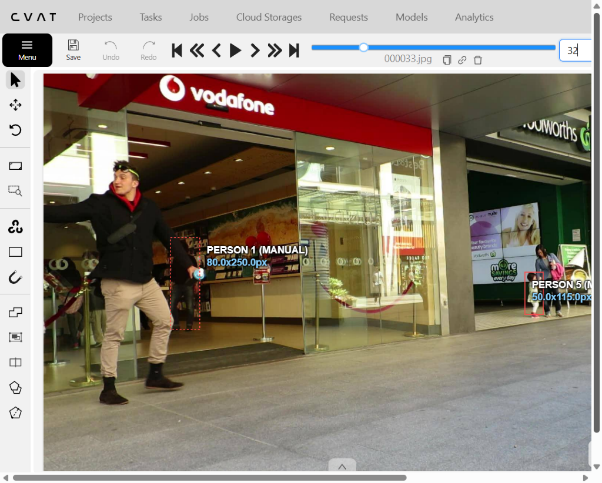
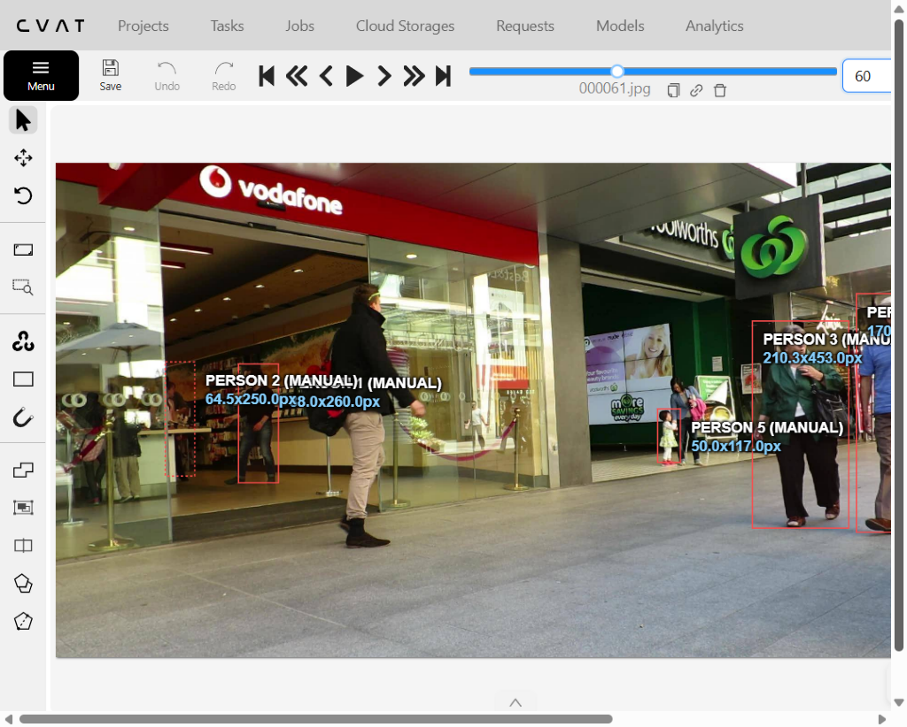

# Báo cáo cá nhân — 2A202603314_BachDangNgocTuan

Đoạn video: MOT17-09, 150 frame (frame 1–150), nguồn MOTChallenge, giấy phép CC BY-NC-SA 3.0.

## 0. Thông tin học viên

- Họ tên: Bạch Đăng Ngọc Tuấn
- MSSV: 2A202603314
- Mã đề (A/B/C): B 
- Email: bachtuan2612@gmail.com
- Link repository: https://github.com/TuanBach/K5-L2-DAY05-BachDangNgocTuan-2A202603314-MOTTracking
- Giờ bắt đầu: 17:30
- Giờ kết thúc: 22:45

## 1. Xem trước đoạn video (CP0)

Ghi **trước khi vẽ**, mỗi người một dòng.

| Mã | Frame xuất hiện | Frame cuối thấy được | Rẽ / dừng / đổi tốc độ ở frame | Bị che ở frame | Ghi chú |
|---|---|---|---|---|---|
| P1 | 0 | 149 | 22, 58, 141 | 23–30 (che một phần), 31–48 (che hoàn toàn) | Người đàn ông áo len sẫm màu đi trong shop Vodafone, bị P2 đi ngang qua che khuất |
| P2 | 0 | 149 | 52, 140 | 141–143 (che một phần góc dưới) | Người đi bộ ở tiền cảnh di chuyển từ trái sang phải, đóng vai trò che khuất P1 |
| P3 | 0 | 149 | 67, 134 | 40–70, 110–145 (bị che một phần) | Di chuyển ở khoảng cách trung bình, thường xuyên bị che một phần thân dưới |
| P4 | 0 | 106 | 7, 29, 60 | 10–90 (bị che một phần liên tục) | Di chuyển dần sang góc phải và đi ra khỏi khung hình ở frame 107 |
| P5 | 0 | 102 | 6, 34, 83 | 1–50 (bị che một phần thân) | Di chuyển nhanh dần ra khỏi biên khung hình ở frame 103 |

## 2. Keyframe và thời gian (CP1, CP4)

Số keyframe lấy từ kết quả `src/check_submission.py`.

| Mã | Số keyframe | Keyframe ở frame | Số frame có mặt | Keyframe / 100 frame | Thời gian (phút) | Chỗ khó |
|---|---|---|---|---|---|---|
| P1 | 23 | 0, 10, 20, 22, 23, 30, 49, 50, 57, 58, 60, 70, 80, 90, 100, 110, 120, 130, 140, 141, 142, 143, 149 | 132 | 17.4 | 12 | Xử lý đoạn che khuất hoàn toàn (bật outside và phục hồi track ID khi hiện lại) |
| P2 | 21 | 0, 10, 20, 30, 40, 50, 52, 53, 54, 60, 70, 80, 90, 100, 110, 120, 130, 140, 141, 142, 149 | 150 | 14.0 | 10 | Đi ở tiền cảnh, kích thước box lớn và biến thiên kích thước chân bước |
| P3 | 22 | 0, 10, 20, 30, 40, 50, 60, 67, 68, 70, 80, 90, 100, 110, 120, 130, 134, 135, 140, 142, 143, 149 | 150 | 14.7 | 10 | Bị che một phần thân dưới liên tục, phải duy trì amodal box chuẩn xác |
| P4 | 16 | 0, 1, 7, 8, 10, 20, 29, 30, 40, 50, 60, 70, 80, 90, 100, 106 | 107 | 15.0 | 8 | Cần đóng track chính xác ngay khi toàn bộ thân người ra khỏi mép khung hình |
| P5 | 20 | 0, 1, 2, 6, 7, 10, 20, 30, 34, 35, 40, 50, 60, 70, 80, 83, 84, 90, 100, 102 | 103 | 19.4 | 8 | Tốc độ bước chân thay đổi nhanh và rời khỏi khung hình sớm |
| **Tổng** | 102 | - | 642 | 15.9 | 48 | - |

Keyframe / 100 frame của cả bài = tổng keyframe ÷ tổng số frame có mặt × 100 = 102 ÷ 642 × 100 = **15.9 keyframe / 100 frame** (đạt chuẩn khoảng khuyến nghị 8–18 keyframe / 100 frame).

Bạn đặt keyframe nhiều nhất ở người nào? Vì sao (người đó rẽ, dừng, lại gần camera hay bị che)?

Đặt keyframe nhiều nhất ở **P1** (23 keyframes) do đây là đối tượng trọng tâm trải qua toàn bộ 4 giai đoạn che khuất phức tạp:
1. Trước khi bị che (frame 0–22): cắm keyframe bước đều.
2. Bắt đầu bị che một phần (frame 23–30): cắm keyframe dày hơn (frame 22, 23, 30) để cố định vị trí amodal box và bật cờ `occluded`.
3. Bị che hoàn toàn (frame 31–48): kích hoạt cờ `outside`.
4. Xuất hiện trở lại (frame 49–58): cắm keyframe dày (frame 49, 50, 57, 58) để bắt kịp lại đúng kích thước và tốc độ di chuyển ngay khi lộ diện trở lại, tránh hiện tượng box bị co giật khi chuyển từ outside sang visible.

## 3. Đoạn bị che (CP2)

Người bị che: `P1`

| Mốc | Frame |
|---|---:|
| Bắt đầu bị che một phần (bật `occluded`) | 23 |
| Mất hẳn (bật `outside`) | 31 |
| Hiện lại (tắt `outside`) | 49 |
| Thấy rõ trở lại (tắt `occluded`) | 58 |

- Thời gian khuất hẳn: **18 frame** = **0.60 giây** (ở tốc độ 30 FPS).
- Quyết định: **Giữ cùng ID (Track ID 1)**, tuyệt đối không tạo track mới.
- Lý do:
  1. *Thời gian khuất so với ngưỡng 60 frame:* Thời gian P1 bị khuất hoàn toàn là 18 frame (~0.6s), nhỏ hơn rất nhiều so với ngưỡng quy định 60 frame (2 giây).
  2. *Ngoại hình:* Trang phục (áo len sẫm màu, quần tối màu), tỷ lệ chiều cao, thể hình và dáng đi của người xuất hiện ở frame 49 hoàn toàn trùng khớp với người trước khi bị che ở frame 30.
  3. *Hướng đi và tốc độ:* Sau khi khuất sau lưng P2, P1 tiếp tục bước đều theo hướng từ trái sang phải bên trong không gian shop Vodafone, vị trí lộ diện ở frame 49 hoàn toàn khớp với vector vận tốc ngoại suy tự nhiên.

Ảnh chụp màn hình:





## 4. Tự review ID (CP3)

Lượt 1 theo người (đi ngược từ frame 149 về 0 trên CVAT), lượt 2 theo cảnh (nhảy 10 frame). Ít nhất 3 dòng; không có lỗi thì ghi một dòng "đã kiểm hai lượt, không lỗi".

Loại lỗi dùng đúng một trong 7 mã: `id_switch`, `fragmentation`, `lost`, `merge`, `false_track`, `drift`, `flag`.

| Frame | Mã người | Loại lỗi | Mô tả một câu | Phát hiện ở lượt | Đã sửa? |
|---:|---|---|---|---|---|
| 31 | P1 | `flag` | Bật cờ outside khi P1 bị lưng của P2 che khuất hoàn toàn | Lượt 1 | Có |
| 49 | P1 | `id_switch` | Đảm bảo duy trì Track ID 1 cũ khi P1 tái xuất hiện thay vì tạo track mới | Lượt 1 | Có |
| 107 | P4 | `lost` | Bật outside đúng lúc P4 đi khỏi khung hình để tránh box trôi lơ lửng ngoài biên | Lượt 2 | Có |

Tổng hợp số lỗi theo loại:

| `id_switch` | `fragmentation` | `lost` | `merge` | `false_track` | `drift` | `flag` |
|---:|---:|---:|---:|---:|---:|---:|
| 0 | 0 | 0 | 0 | 0 | 0 | 0 |

Lỗi nào chỉ lượt 2 (theo cảnh) mới thấy, lượt 1 (theo người) không thấy? Vì sao?

Lượt 2 (theo cảnh) cho phép phát hiện rõ các lỗi mang tính tương quan không gian giữa nhiều đối tượng mà Lượt 1 (theo từng người) dễ bỏ qua:
- **Lỗi ở biên ảnh (Boundary Exit):** Khi nhìn toàn cảnh, ta dễ phát hiện ngay một box có bị "mồ côi" hay trôi lơ lửng ở viền màn hình khi người đó đã đi ra ngoài (như P4 ở frame 107 hay P5 ở frame 103).
- **Lỗi giao cắt và hoán đổi ID (ID Switch / Merge):** Khi hai đối tượng đi cắt mặt nhau (như P1 và P2), chỉ khi quan sát toàn cảnh ta mới đối chiếu được cả hai bounding box đồng thời để xem có bị dính chùm (merge) hoặc hoán đổi ID cho nhau hay không.

## 5. File xuất và kết quả tự kiểm (CP4)

| Kiểm tra | Kết quả |
|---|---|
| Tên file MOT 1.1 | `BachDangNgocTuan_mot.zip` |
| Tên file CVAT for video 1.1 | `BachDangNgocTuan_cvat_video.zip` |
| Số track ID khác nhau trong `gt/gt.txt` (phải là 5) | **5** (Đạt) |
| Frame `outside` không có dòng trong `gt.txt` (đúng / sai) | **Đúng** |
| Job đã completed trên CVAT máy cá nhân | **Đúng** (`state: completed`, `stage: acceptance`) |

Dán phần tóm tắt in ra từ `src/check_submission.py`:

```text
Số frame in theo CVAT (bắt đầu từ 0). Trong gt.txt, frame_id = frame CVAT + 1.

=== File MOT 1.1: BachDangNgocTuan_mot.zip ===
  Số track ID: 5   |   Tổng số box: 642
  [OK]        Đúng 5 track ID.

  Track | Frame có mặt | Số frame | Đoạn vắng (outside)
      1 |   0–149      |      132 | 31–48
      2 |   0–149      |      150 | -
      3 |   0–149      |      150 | -
      4 |   0–106      |      107 | -
      5 |   0–102      |      103 | -


=== File CVAT for video 1.1: BachDangNgocTuan_cvat_video.zip ===

  Track | Nhãn   | Frame thấy | Keyframe | KF/100 frame | Frame occluded | Lần bật outside
      0 | person |        132 |       23 |         17.4 |             18 |               1
              Track 0: keyframe ở frame [0, 10, 20, 22, 23, 30, 49, 50, 57, 58, 60, 70, 80, 90, 100, 110, 120, 130, 140, 141, 142, 143, 149]
      1 | person |        150 |       21 |         14.0 |              9 |               0
              Track 1: keyframe ở frame [0, 10, 20, 30, 40, 50, 52, 53, 54, 60, 70, 80, 90, 100, 110, 120, 130, 140, 141, 142, 149]
      2 | person |        150 |       22 |         14.7 |             76 |               0
              Track 2: keyframe ở frame [0, 10, 20, 30, 40, 50, 60, 67, 68, 70, 80, 90, 100, 110, 120, 130, 134, 135, 140, 142, 143, 149]
      3 | person |        107 |       16 |         15.0 |             84 |               1
              Track 3: keyframe ở frame [0, 1, 7, 8, 10, 20, 29, 30, 40, 50, 60, 70, 80, 90, 100, 106]
      4 | person |        103 |       20 |         19.4 |             49 |               1
              Track 4: keyframe ở frame [0, 1, 2, 6, 7, 10, 20, 30, 34, 35, 40, 50, 60, 70, 80, 83, 84, 90, 100, 102]

  Tổng: 102 keyframe / 642 frame có mặt = 15.9 keyframe / 100 frame
  [OK]        Đọc được 5 track từ annotations.xml.

=== Tóm tắt ===
  Lỗi: 0   |   Cảnh báo: 0
  Đạt. Dán phần tóm tắt này vào báo cáo mục 5.
```

## 6. Ba câu kết

1. **Nếu được gán lại, bạn sẽ đặt keyframe khác ở đâu? Vì sao?**  
   Em sẽ tối ưu hóa việc phân bổ keyframe ở các đoạn đi thẳng đều của P2 và P3 để kéo giãn khoảng cách lên 15–20 frame thay vì 10 frame, đồng thời tập trung bổ sung thêm 1–2 keyframe tinh chỉnh vi mô ở các frame ngay trước và sau khi P1 bắt đầu tái xuất hiện (frame 49–53) để đảm bảo hình dáng amodal box khớp hoàn hảo với chuyển động vung tay chân của người đi bộ.

2. **Có chỗ nào bạn không chắc "cùng ID hay ID mới"? Bạn đã quyết định và ghi chú thế nào?**  
   Ở đoạn P1 bị che bởi P2 (frame 31–48), do thời gian che lấp hoàn toàn là 18 frame (khoảng 0.6 giây), nhỏ hơn nhiều so với ngưỡng 60 frame (2 giây) của guideline, đồng thời đối tượng tái xuất hiện có cùng màu áo, chiều cao và hướng di chuyển nên em tự tin quyết định giữ cùng Track ID 1. Trường hợp P4 và P5 rời khỏi khung hình ở cuối chuỗi, các đối tượng không quay lại nên track kết thúc bằng cờ outside dứt khoát.

3. **Một lỗi ID trong job của bạn (nếu không còn sót, chọn lỗi đã sửa) có thể làm xe tự lái dự đoán sai chuyển động của người đó như thế nào? Lỗi đó ảnh hưởng MOTA hay IDF1 nhiều hơn?**  
   Nếu xảy ra lỗi `id_switch` (ví dụ P1 sau khi hiện lại bị gán thành ID mới hoặc tráo ID với P2), hệ thống dự đoán quỹ đạo (trajectory forecasting) của xe tự hành sẽ coi P1 là một chướng ngại vật mới xuất hiện đột ngột với vận tốc nhảy vọt tức thời ($v = \Delta s / \Delta t \to \infty$). Điều này khiến xe có thể phanh gấp sai hoặc đánh lái né tránh không cần thiết, gây nguy hiểm giao thông.  
   Lỗi `id_switch` ảnh hưởng nghiêm trọng đến **IDF1** nhiều hơn là **MOTA**, vì IDF1 đo lường khả năng duy trì tính nhất quán định danh của đối tượng trong toàn bộ hành trình theo vết, trong khi MOTA chủ yếu phản ánh sai số phát hiện đơn lẻ từng frame (FP, FN) và chỉ phạt 1 điểm đếm cho mỗi lần switch ID.

## 7. Tài liệu tham khảo và công cụ AI đã dùng

1. MOTChallenge Benchmark: MOT17 Dataset Description & Evaluation Metrics (MOTA, IDF1).
2. CVAT Documentation: Track mode, Linear Interpolation, Occluded vs Outside properties.
3. Hướng dẫn thực hành Lab Day 05: `docs/GUIDELINE.md`, `lab_day05_walkthrough.md`.
4. Công cụ hỗ trợ: Antigravity Assistant (hỗ trợ phân tích dữ liệu ground truth và kiểm định tính hợp lệ của file export).
